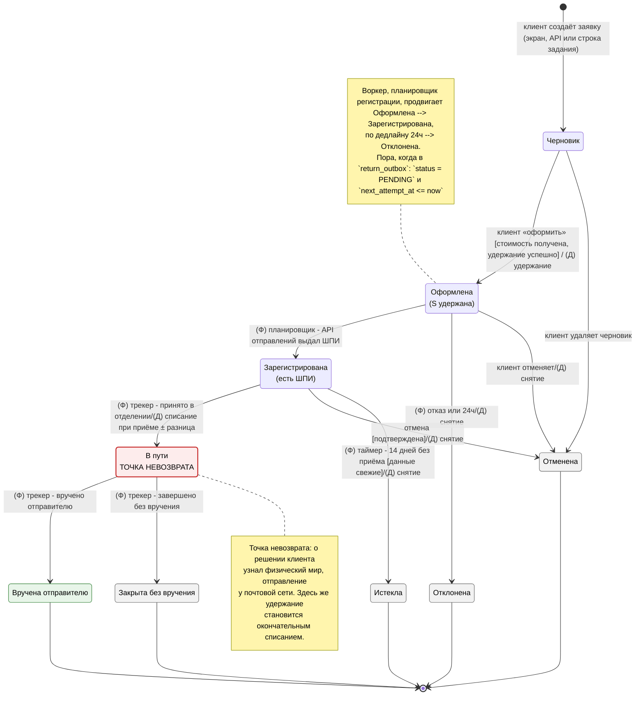

Черновики: З-6, З-7, З-8

Сроки 24ч, 14 дней, 24ч свежести данных отслеживания и период воркера 1 мин это учебные допущения.
# Диаграмма состояний

Обозначения:
- клиент ... - переход по команде клиента (экран, API, строка задания)
- (Ф) - переход продвигает воркер
- `[...]` - условие перехода
- (Д) - денежная точка (удержание, снятие удержания, списание при приеме)
- красная рамка - точка невозврата
- зеленая рамка - успешное конечное состояние
- серая рамка - конечные состояния отказа
  
Воркер продвигает переход "Оформлена - Зарегистрирована", и узнает когда пора по полям задачи в `return_outbox`: `status = 'PENDING'` и `next_attempt_at <= now()`. После неудачи он сдвигает `next_attempt_at` на растущую паузу. По дедлайну 24ч продвигает "Оформлена - Отклонена".
## Поведение при недоступности смежного сервиса

| Какой сервис недоступен           | На каком переходе                         | В каком состоянии окажется заявка                                                                          | Что увидит пользователь                                                                                                       |
| --------------------------------- | ----------------------------------------- | ---------------------------------------------------------------------------------------------------------- | ----------------------------------------------------------------------------------------------------------------------------- |
| Тарификатор                       | Черновик - Оформлена                      | "Черновик"                                                                                                 | "Расчёт стоимости временно недоступен, черновик сохранён, оформите позже"                                                     |
| Онлайн Баланс (удержание)         | Черновик - Оформлена                      | "Черновик"                                                                                                 | "Не удалось зарезервировать средства, черновик сохранён"                                                                      |
| Онлайн Баланс (снятие / списание) | следствия переходов в отказ и "- В пути"  | Заявка переходит дальше как обычно, команда ждёт в `return_outbox`                                         | "Принят в отделении, списание в обработке" или "удержание будет снято"                                                        |
| API отправлений                   | Оформлена - Зарегистрирована              | "Оформлена"                                                                                                | "Ожидает регистрации, ШПИ появится позже". Через 24ч - "Не удалось зарегистрировать, удержание снято, создайте заявку заново" |
| API отправлений                   | Зарегистрирована - Отменена               | "Зарегистрирована"                                                                                         | 503 "Отмена временно недоступна, повторите позже"                                                                             |
| Корп. шина/сервис отслеживания    | - В пути - Вручена/ Закрыта - Истекла     | Остаётся в последнем известном состоянии                                                                   | Последний известный статус с пометкой о времени                                                                               |
| RabbitMQ                          | поводы проверить статус, денежные команды | Переходы идут, так как трекер сам опрашивает статус, только позже. Денежные команды ждут в `return_outbox` | "Списание в обработке"                                                                                                        |

## Определение состояний (из бланка 3-6)

| **Состояние**        | **Что с сущностью можно делать**                                                              | **Что нельзя**                                 |
| -------------------- | --------------------------------------------------------------------------------------------- | ---------------------------------------------- |
| Черновик             | Вводить данные покупателя, адрес возврата, причину, вес, тип отправления, удалить черновик    | Получить ШПИ, скачать или переслать ярлык      |
| Ожидает ШПИ          | Смотреть зафиксированную стоимость и статус регистрации                                       | Править данные, аннулировать, пересылать ярлык |
| Требует исправления  | Видеть причину отказа API и номер попытки, исправить поля, отказаться от возврата             | Менять вес и тип отправления, скачивать ярлык  |
| Выдан покупателю     | Видеть ШПИ и срок сдачи, скачать ярлык, повторно переслать его покупателю, аннулировать ярлык | Править данные                                 |
| Принят в отделении   | Отслеживать отправление, видеть списанную стоимость и ожидаемую дату получения                | Аннулировать, править данные                   |
| Получен организацией | Смотреть историю, причину возврата и сумму списания                                           | Аннулировать, править данные                   |
| Аннулирован          | Смотреть историю, создать новый ярлык (копию этого)                                           | Возобновить этот ярлык                         |
| Не выпущен           | Смотреть причину, число попыток, создать новый ярлык на основе этого                          | Повторно отправить этот ярлык на регистрацию   |
| Просрочен            | Смотреть историю, выпустить покупателю новый ярлык                                            | Сдать возврат по этому ШПИ                     |
| Завершен             | Смотреть причину от почтовой сети, подать заявление на розыск                                 | Аннулировать, править данные                   |

## Запрещённые переходы и что система делает при попытке

| Из состояния                | Попытка                                            | Что возвращает или делает система                                                                                                          |
| --------------------------- | -------------------------------------------------- | ------------------------------------------------------------------------------------------------------------------------------------------ |
| В пути                      | Отменить                                           | 409 "Возврат уже принят в отделении, отмена невозможна"                                                                                    |
| Оформлена, Зарегистрирована | Изменить данные заявки                             | 409 "После оформления данные не меняются: отмените заявку и создайте новую"                                                                |
| Любое конечное              | Любая команда, кроме чтения                        | 409 "Заявка закрыта" с её конечным состоянием.                                                                                             |
| Черновик                    | Печать ярлыка, запрос ШПИ                          | 409 «Сначала оформите заявку»                                                                                                              |
| Черновик                    | "Оформить" когда баланс отказал в удержании        | 422 "Недостаточно средств на балансе, черновик сохранён", остаётся «Черновиком».                                                           |
| Черновик, Оформлена         | Событие почтовой сети по заявке (принято, вручено) | Не применяется, так как у заявки ещё нет ШПИ. Ошибка пишется в журнал, заявка остаётся в своём состоянии                                   |
| В пути, Вручена             | Повторное "принято в отделении"                    | Событие совпадает с текущим состоянием и не применяется. Если повтор отличается по содержанию (другой вес), он уходит в разбор             |
| Отменена, Истекла           | "Принято в отделении"                              | Перехода нет, потому что из конечного состояния нет выхода. Событие пишется в раздел "не сопоставлены" и попадает в ручную очередь сверки. |
| Зарегистрирована            | "Отменить", когда API отправлений недоступен       | 503 "Отмена временно недоступна, повторите позже"; состояние не меняется.                                                                  |
## Переходы и событийные уведомления

| Переход                                        | Событие или условие                                                                                                             | Кто инициирует           |
| ---------------------------------------------- | ------------------------------------------------------------------------------------------------------------------------------- | ------------------------ |
| Черновик - Оформлена                           | Команда клиента "оформить". Условия - тарификатор вернул стоимость, баланс выполнил удержание                                   | клиент или строка пакета |
| Оформлена - Зарегистрирована                   | API отправлений вернул ШПИ возвратного отправления                                                                              | планировщик регистрации  |
| Оформлена - Отклонена                          | API отправлений отказал или регистрация не удалась за 24ч                                                                       | планировщик регистрации  |
| Черновик/Оформлена/Зарегистрирована - Отменена | Команда клиента «отменить» (или "удалить" из "Черновика"), из "Зарегистрированной" - после подтверждения отмены в почтовой сети | клиент                   |
| Зарегистрирована - Истекла                     | Условие- 14 дней без приёма в отделении при свежих данных отслеживания                                                          | таймер                   |
| Зарегистрирована - В пути                      | Почтовая сеть зафиксировала приём - продвигает внешний контур                                                                   | трекер                   |
| В пути - Вручена/Закрыта без вручения          | Почтовая сеть зафиксировала вручение или иное завершение - продвигает внешний контур                                            | трекер                   |
